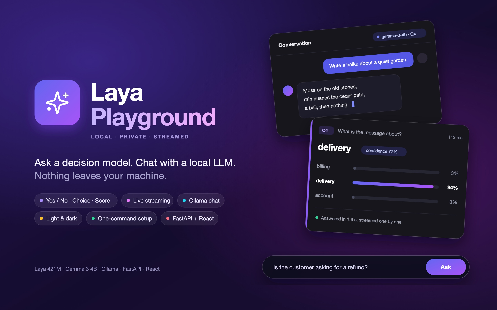

# Laya playground

[](pyproject.toml)
[](backend/app.py)
[](frontend/package.json)
[](frontend/tsconfig.json)
[](frontend/src/index.css)
[](https://ollama.com)



> Ask a small decision model typed questions about a text, or chat with a local language model, and watch every answer stream in. Everything runs on your machine.

The playground has two tabs. **Decide** asks [Laya](https://huggingface.co/convaiinnovations/laya), a 421M-parameter decision model, yes/no, choice or score questions about a text, and shows each answer with every option's probability. **Chat** talks with any model in [Ollama](https://ollama.com), with the reply written word by word.

- **Live streaming:** answers and replies appear as the models produce them; Stop cancels at once.
- **Minimal typing:** question templates, options added with Enter, and example chat prompts.
- **Easy on memory:** each model loads for its task and unloads when idle.
- **Private:** nothing you type is sent anywhere, saved on the server or written to the logs.
- **Light and dark:** a System, Light or Dark theme, on phones and laptops alike.

## Quick start

You need macOS or Linux, [uv](https://docs.astral.sh/uv/) and Node.js 20+. [Ollama](https://ollama.com) is optional and only needed for Chat.

```bash
make setup   # installs everything and downloads the models; safe to rerun
make app     # opens at http://127.0.0.1:8100
```

## Documentation

| Read | For |
|---|---|
| [Setup](docs/setup.md) | What `make setup` does, choosing the chat model, reusing a Laya copy |
| [Usage](docs/usage.md) | How to use the Decide and Chat tabs |
| [Architecture](docs/architecture.md) | The two models and how a request travels through the app |
| [Configuration](docs/configuration.md) | Every `.env` setting |
| [API](docs/api.md) | The streaming endpoints, with curl examples |
| [Development](docs/development.md) | Commands, project layout, conventions and common changes |
| [Troubleshooting](docs/troubleshooting.md) | Common problems and their fixes |
